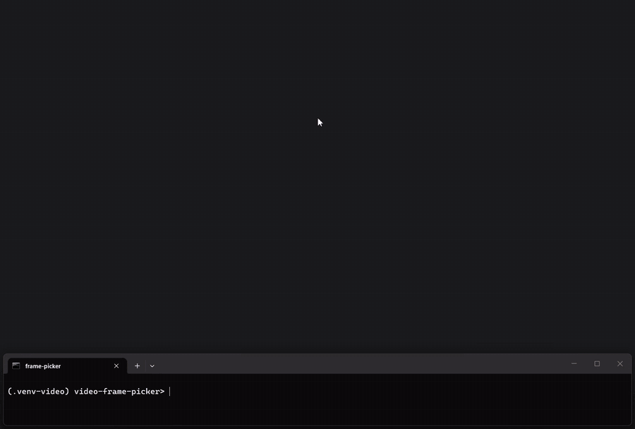
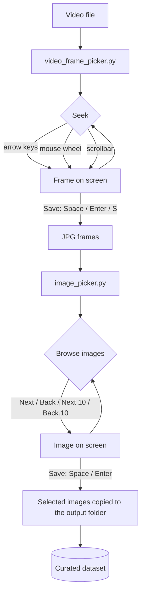

# video-frame-picker

Two small desktop tools (Tkinter + OpenCV + Pillow) for building image datasets by hand:

| Script | What it does |
|---|---|
| `video_frame_picker.py` | Opens a video, lets you jump through frames with the keyboard, mouse wheel or scrollbar, and saves the frames you choose as JPG. |
| `image_picker.py` | Opens a folder of images, lets you browse them and copies the ones you choose to an `output_<folder>` directory. |



## How it works



1. `video_frame_picker.py` opens a video; you seek with the keys, the mouse wheel or the scrollbar and save the frames you want as JPG.
2. `image_picker.py` opens the folder with those frames (or any image folder) so you can review them one by one.
3. The images you keep are copied to the output folder, which becomes the curated dataset.

## Installation

Requires Python 3.8+. Tkinter is included in the standard Python installers for Windows and macOS. On Debian/Ubuntu install it separately:

```bash
sudo apt install python3-tk
```

### Linux / macOS (bash)

```bash
git clone https://github.com/karemdm/video-frame-picker.git
cd video-frame-picker
python3 -m venv .venv
source .venv/bin/activate
pip install -r requirements.txt
```

### Windows (PowerShell)

```powershell
git clone https://github.com/karemdm/video-frame-picker.git
cd video-frame-picker
python -m venv .venv
.venv\Scripts\Activate.ps1
pip install -r requirements.txt
```

If PowerShell blocks the activation script, run `Set-ExecutionPolicy -Scope Process RemoteSigned` in that window first.

## Try it with the examples

The `examples/` folder has a short street video and a few photos (see [examples/README.md](examples/README.md)):

```bash
# pick frames from the video into dataset/frames
python video_frame_picker.py examples/abbey_road_15s.mp4 --out dataset/frames

# curate the photos into dataset/images
python image_picker.py examples/street_photos --out dataset/images
```

## video_frame_picker.py

```bash
python video_frame_picker.py [VIDEO] [--out DIR] [--steps A,B,C]
```

Without arguments a file dialog asks for a video (`.mp4`, `.mov`, `.avi`, `.3gp`). Pass a `VIDEO` path to skip the dialog and `--out DIR` to choose the folder for the saved frames (created if missing). `--steps A,B,C` sets the frame steps (three integers >= 2, default `40,200,800`): `A` for `→`/`←`, `B` for `↓`/`↑`, `C` for the mouse wheel. Moving back with the arrow keys uses half of `A` or `B`; the wheel uses `C` in both directions.

| Key / control | Action |
|---|---|
| `→` | forward 40 frames (`A`) |
| `←` | back 20 frames (`A/2`) |
| `↓` | forward 200 frames (`B`) |
| `↑` | back 100 frames (`B/2`) |
| Mouse wheel (over the video) | down: forward 800 frames, up: back 800 frames (`C`) |
| Scrollbar | seek anywhere in the video |
| `Space`, `Enter`, `S` or **Save Frame** button | save the frame on screen |
| `Q` | quit |
| **Open New Video** button | open another video |

Frames are saved in `--out DIR` (default: the **current working directory**) as
`<video name, accents removed>_frame_<n>.jpg` (`<n>` = 0-based frame index).
A status line under the buttons confirms each save, e.g. `Saved abbey_road_15s_frame_120.jpg (3 saved)`.

## image_picker.py

```bash
python image_picker.py [FOLDER] [--out DIR]
```

Without arguments a folder dialog asks for an image folder (`.png`, `.jpg`, `.jpeg`, `.bmp`, `.tiff`); pass `FOLDER` to skip it.
Selected images are copied to `--out DIR` (created if missing), or by default to `output_<folder name>` next to the input folder. Each copy is named `output_<original file name>`.
A status line shows each save, e.g. `Saved output_img0.jpg (1 saved)`.

| Key / button | Action |
|---|---|
| `→` / **Next** | next image |
| `←` / **Back** | previous image |
| `↓` / **Next 10** | forward 10 images |
| `↑` / **Back 10** | back 10 images |
| `Space`, `Enter` / **Save** | copy image to the output folder and go to the next one |
| **Open Image Folder** | choose another folder |

## Preview

The video preview is sized for each opened video (aspect ratio kept, fitted to the screen). `image_picker.py` shows images in a fixed 600x400 area, letterboxed to keep their aspect ratio; the copied file is never modified.

## Tests

The pure helpers (`--steps` parsing, preview size, output file names) have standard-library tests that open no window:

```bash
python -m unittest discover -s tests
```

## License

[MIT](LICENSE)
